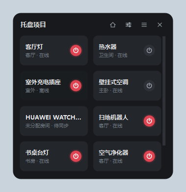
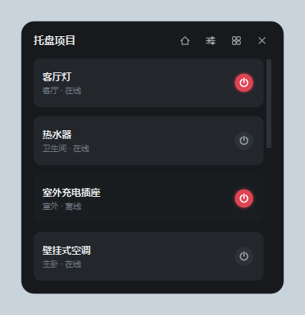
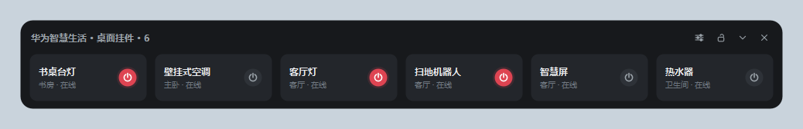
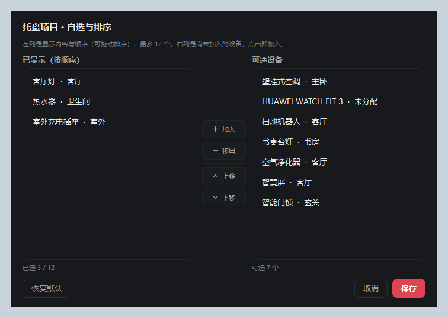
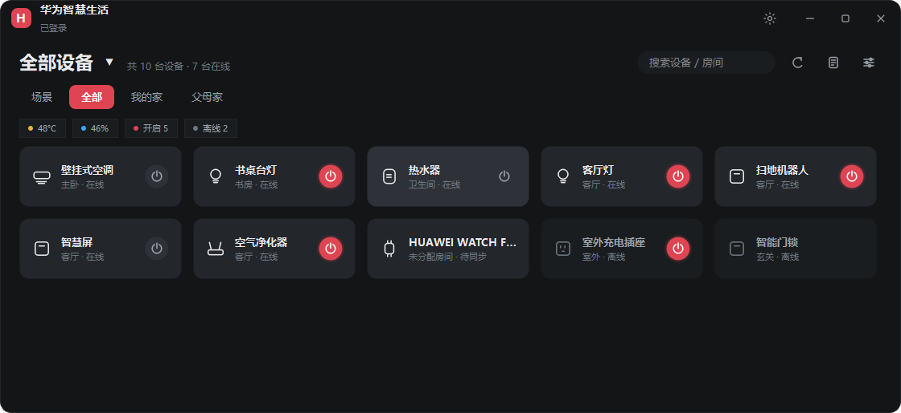
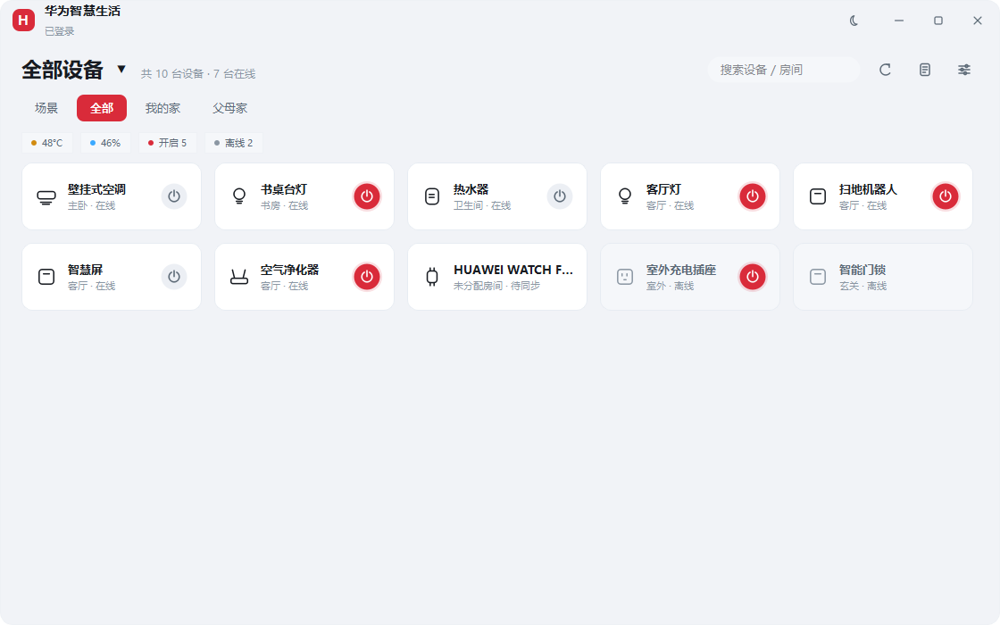
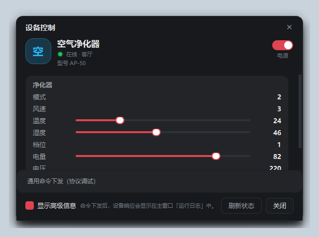
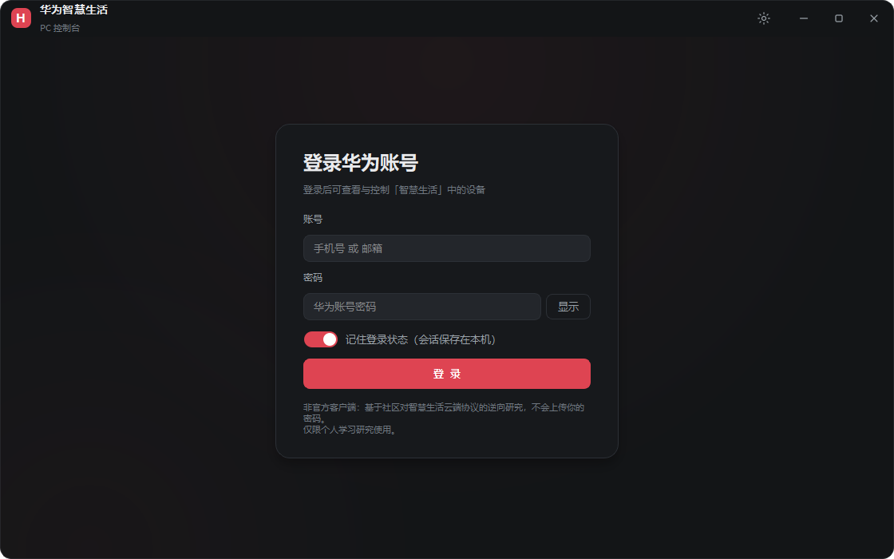
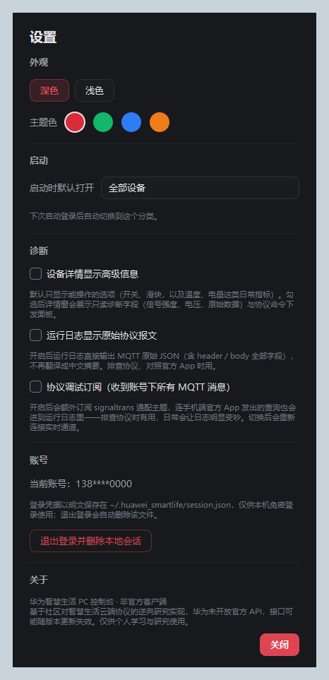

# 华为智慧生活 PC 控制台

Windows 桌面端的华为智慧生活控制程序：华为账号登录（含会话保持）、设备列表、  
状态查询与基本控制（开关 / 亮度 / 温度 / 模式等）。GUI 使用 **PySide6 (Qt 6) + QSS**，  
窗口结构、设备卡片与状态面板参考 [MiHome-Windows](https://github.com/huanyuejue/MiHome-Windows)。

> ⚠️ **非官方项目**：与华为技术有限公司无任何关联，未获其授权或认可。
> 华为未向个人开放智慧生活 API，本项目基于社区对 App 云端协议的逆向研究
> （参考 `ha-huawei-smarthome`）实现，接口与参数可能随华为版本更新而失效。
>
> 「华为」「HUAWEI」「智慧生活」等是华为技术有限公司的商标，本项目仅作指代使用。
> **仅供个人学习与研究，请遵守华为服务条款，不得用于商业用途。**
> 使用本项目造成的任何后果（包括账号被限制、设备异常）由使用者自行承担。

---

## 功能

| 功能      | 状态 | 说明                                           |
| ------- | -- | -------------------------------------------- |
| 账号密码登录  | ✅  | RSA-OAEP/SHA256 加密密码，二次验证默认走设备验证码（可一键改用短信）   |
| 会话保持    | ✅  | Token 与刷新令牌保存本地，下次启动免密恢复并自动刷新                |
| 设备列表    | ✅  | 按家庭分组、在线状态、房间信息，流式卡片网格自适应窗口宽度                |
| 状态查询    | ✅  | REST 快照 + 动态状态接口 + MQTT 遥测实时更新               |
| 基本控制    | ✅  | 主开关、属性滑块、文本属性；只读诊断与命令面板收进「显示高级信息」        |
| 智能场景    | ✅  | 列出并一键执行手动场景（端点基于逆向推断）                        |
| 系统托盘    | ✅  | 托盘图标 + 右键菜单（主界面 / 托盘面板 / 桌面挂件 / 退出），关闭窗口收进托盘 |
| 托盘面板    | ✅  | 托盘图标左键弹出设备浮层，双列/单列切换，卡片上直接开关（不弹详情）           |
| 桌面挂件    | ✅  | 常驻桌面横向设备条，可拖动、置顶、锁定、收起，位置与状态持久化              |
| 设备自选与排序 | ✅  | 托盘面板与桌面挂件均可自选设备、自由排序，顺序持久化                   |
| 运行日志    | ✅  | 中文摘要（`热水器 · 电源 电流 1717mA`），遥测默认折叠、按需展开   |
| 摄像头     | ⚠️ | 消费级摄像头走私有加密协议，PC 端无法直接拉流（库中保留了 RTSP 辅助）      |

## 界面

结构与参考项目 MiHome-Windows 一致：顶部筛选区 + 胶囊 Tab + 状态胶囊 + 卡片网格，  
没有侧边栏，所有设备平铺并按状态排序。

```
┌──────────────────────────────────────────────────────────────┐
│  H  华为智慧生活                ☀  —  □  ✕        │ ← 自绘标题栏
├──────────────────────────────────────────────────────────────┤
│  全部设备 ▾   共 17 台设备 · 12 台在线   🔍搜索   ⟳   ▤   ⚙   │
│  [场景] [全部] [我的家] [父母家] [其他设备]                     │
│  ● 22.1°C   ● 66%   ● 开启 7   ● 离线 1                       │
│  ┌──────────────┐ ┌──────────────┐ ┌──────────────┐          │
│  │ ◯ 客厅灯   ⏻  │ │ ◯ 热水器   ⏻  │ │ ◯ 空调       │          │
│  │   客厅 · 在线 │ │   卫生间 · 在线│ │   主卧 · 在线 │          │
│  └──────────────┘ └──────────────┘ └──────────────┘          │
└──────────────────────────────────────────────────────────────┘
```

- **顶部标题**：当前筛选（全部 / 家庭 / 其他设备），点击展开菜单也能切到场景与日志
- **胶囊 Tab**：场景 / 全部 / 各家庭，选中态用主题色填充
- **状态胶囊**：温度、湿度、开启数量、离线数量，按当前筛选范围实时统计
- **设备卡片**：线条图标 + 名称 + 房间·在线状态 + 三态电源按钮（开=主题色实心带光晕、  
  关=灰底、未知=描边）；无开关能力的设备（路由、手环、传感器）不显示电源键
- **卡片排序**：在线 → 状态未知 → 离线，同组内按房间/名称排，离线卡片整体压暗
- **列数自适应**：按窗口宽度算列数与卡片宽度，铺满一行且不出现半截卡片
- 点击卡片 → 设备详情弹窗；点击电源按钮 → 直接开关，不打开详情；
  详情窗默认只显示可操作项，只读诊断与协议命令收在「显示高级信息」后面
- **窗口圆角**：14px 圆角（半透明窗口表面 + QSS 圆角），最大化时自动取消，  
  避免屏幕边缘留缝；标题栏顶部同步圆角
- **启动分类**：设置里可选「启动时默认打开」——全部设备 / 某个家庭 / 智能场景 /  
  运行日志，登录后自动跳转（家庭已不存在时回退到全部设备）
- 深色 / 浅色主题 + 4 种主题色，可自由切换（QSS 变量驱动，即时生效）
- 图标全部用 QPainter 自绘（刷新/日志/设置/主题/窗口按钮 + 设备轮廓），  
  不依赖 `Segoe MDL2` 等图标字体，避免在精简系统上渲染成方块

**系统托盘 / 托盘面板 / 桌面挂件**：

| 托盘面板（双列） | 托盘面板（单列） | 桌面挂件 |
| --- | --- | --- |
|  |  |  |

| 设备自选与排序 |
| --- |
|  |

- 托盘：左键弹出面板，右键菜单含「打开主界面 / 托盘面板 / 桌面挂件 / 退出」；  
  点窗口关闭按钮默认收进托盘（托盘不可用的环境则直接退出）
- 托盘面板：`Qt.Popup` 浮层，点外面自动收起；布局切换（双列/单列）会记住，  
  切完按内容重算高度（5 个设备时双列 268px / 单列 340px），不会拖出空白，  
  也不会因为算矮了把底部圆角挤出窗口；  
  卡片只响应右侧电源键，**点卡片不弹详情**（浮层是快速开关场景，详情走主界面）
- 桌面挂件：只放「有开关能力」的设备，最多 6 张；锁定后禁止拖动，收起后只留标题栏；  
  位置、锁定、收起状态都写进 `ui_settings.json`
- **自选与排序**：面板和挂件的标题栏都有滑杆按钮，打开后左列是「已显示（按顺序）」  
  —— 可拖动或用上移/下移调整顺序，右列是「可选设备」，点一下就加入。  
  保存后顺序立即生效并写入配置；留空等于恢复默认（在线优先 + 名称）。  
  自选是「只显示我挑的」，快照里新增的设备不会自动插进来
- **两者都是独立顶层窗口**（`parent=None`），主界面最小化 / 收进托盘时不会跟着消失；  
  挂件本来就是常驻桌面的，面板在主界面最小化时也照样能弹出
- 浮层不用 `QGraphicsDropShadowEffect` 投影：透明窗口上它是纯黑 alpha，留白不足时  
  会被裁成硬边方框（看起来就是周围一圈黑雾），改用描边 + 圆角表达层次
- 浮层的圆角由 `widgets/rounded_surface.py` 自绘：QSS 的 `border-radius` **不做抗锯齿**，  
  在半透明窗口上与壁纸混合就是一圈灰色毛边；改用 QPainter + Antialiasing，  
  半径 16px，描边取更淡的 `border_soft`

界面预览：

| 主界面（深色） | 主界面（浅色） |
| --- | --- |
|  |  |

| 设备详情 | 登录页 | 设置 |
| --- | --- | --- |
|  |  |  |

> 截图里的设备、家庭与账号都是虚构示例，由 `_gen_screenshots.py` 用假数据生成，
> 不含任何真实用户数据。想自己重出图：`python _gen_screenshots.py dark`。

| 设置（含启动分类） |
| --------- |
|           |

**详情窗默认只放「能动手的」**：开关、滑块、文本属性，以及温度 / 湿度 / 电量 /
风速档位这类日常指标。只读诊断字段（信号强度、电压、原始 JSON）、只读服务
（电量统计、网络信息、故障检测、固件更新）和协议命令下发，全部收进
「显示高级信息」——默认关。

这一项有两个入口，改哪个都算数：详情窗底部的勾选框，以及
**设置 → 诊断 → 设备详情显示高级信息**。选择会写入 `ui_settings.json`，
下次打开沿用；设置改动对已经开着的详情窗立即生效。

这样避免了两件事：一是把 `rssi=-52`、`voltage=220` 这种排查用的数字摆在
日常界面上；二是误触「通用命令下发」直接往设备发原始报文。

**滑块不吃滚轮**：详情窗放在滚动区里，用户想滚页面时鼠标很容易掠过滑块，
而 Qt 默认会让滚轮改值——这个界面上滑块一动就等于往设备发命令（把空调从 26℃
调到 30℃ 只差一次误滚）。现在滚轮事件被转给外层滚动区，页面照常滚、参数不动
（`app/widgets/no_wheel.py`）。

## 安装与运行

要求 Python 3.10+，且该解释器能安装 PySide6（已在 3.13 / 3.15 上验证）。

**最省事**：双击 `run.bat` —— 自动检查依赖并启动（使用 `py -3` 选定的 Python）。

启动器用 `pythonw`（无控制台解释器）运行，脚本自身**启动后立即退出**，所以不会
常驻一个黑窗口——以前那个窗口关掉就等于关掉程序。想连一闪而过的窗口都不要，
双击 `run.vbs`（隐藏窗口启动，依赖没装时会弹提示让你先跑 `run.bat`）。

**手动**：

```bash
py -3 -m pip install -r requirements.txt
py -3 main.py          # 前台运行，日志打到终端
pyw -3 main.py         # 无控制台窗口运行
```

> `pythonw` / `pyw` 没有控制台，`print` 和标准错误都无处可去。所以启动阶段的
> 错误（比如依赖没装）改成系统弹窗提示，运行期日志照常写入
> `~/.huawei_smartlife/app.log`。日志初始化时会先试写一次标准错误，
> 句柄无效就只挂文件 handler，不会因为"没有控制台"把日志整体丢掉。

> 机器上有多个 Python 时，务必让 `pip` 与运行程序的 `python` 是同一个解释器；  
> 若 `python` 指向的是精简版（`import tkinter` 失败、pip 装不上 PySide6），  
> 直接用 `py -3`。日志写在 `~/.huawei_smartlife/app.log`；  
> 若进程被 Qt 层的内存错误直接杀掉（Windows 上只弹一句 "python has stopped  
> working"），栈会写进同目录的 `crash.log`。

首次启动进入登录页：

1. 输入华为账号（手机号 / 邮箱）与密码；
2. 若账号开启了二次验证，页面就地展开验证码区域，**默认用设备验证码**：  
   华为在登录请求被拒时已经把码推到了账号下的设备（`accountType=-1`），  
   抬头看设备就能拿到，不用选渠道、也不用点发送。区域里只有一行提示  
   「华为已向你的设备推送验证码（nova 6 (5G)），请查收」+ 验证码输入框；  
   提示里带「请尽快输入」——华为的验证窗口只有两分钟左右（实测 2 分半必失败，  
   服务端原话 `operation without call getList or call getList too long time`）。  
   超时后点右侧「重新获取」会重新发起一次登录，华为推一条新码；  
   只有短信渠道时按钮是「发送验证码」。提交失败会把华为返回的 `resultCode`  
   一并显示并给出下一步动作。
   > 渠道类型会同步到提交参数 `vAcT`：设备上收到的码必须按设备类型提交，  
   > 否则一定被判无效。所以「改用短信」不只是改界面，也会同步后端的挂起状态  
   > （`switch_challenge_channel`，纯本地、不发请求）。这块之前只改了显示，  
   > 导致切到设备渠道仍然报 70008804。
3. 登录成功后 Token 保存到 `~/.huawei_smartlife/session.json`，下次启动免密进入。

> 若只想看界面而不联网：`set QT_QPA_PLATFORM=offscreen` 后运行自检脚本（见下）。

## 项目结构

```
HUAWEI-SMARTLIFE-PC/
├── main.py                    # 入口（极简，仅做依赖提示）
├── run.bat                    # 一键启动（自检依赖，pythonw 后台运行）
├── run.vbs                    # 无窗口启动（双击即可）
├── requirements.txt
├── _smoke_test.py             # 无头自检（198 项）
├── _gen_screenshots.py        # 用虚构数据生成文档截图
├── huawei_smartlife/          # 协议层（不依赖 GUI）
│   ├── constants.py           # 域名 / App 标识 / REST 路径 / MQTT 参数
│   ├── exceptions.py          # 异常体系
│   ├── models.py              # AuthSession / Device / ServiceState / Scene ...
│   ├── auth.py                # 登录链路（RSA 加密 / 双 Token / 二次验证）
│   ├── api.py                 # REST 客户端（快照 / 动态状态 / 路由 / 场景）
│   ├── mqtt_control.py        # MQTT 控制与命令响应关联
│   ├── camera.py              # 摄像头识别与 RTSP 辅助
│   └── client.py              # 高层客户端（登录 / 查询 / 控制 / 会话持久化）
└── app/                       # GUI 层
    ├── main.py                # 启动引导（高 DPI / 日志 / 异常钩子 / 主题）
    ├── main_window.py         # 无边框主窗口，信号编排
    ├── controller.py          # 业务控制器（登录 / 刷新 / 命令 / MQTT）
    ├── tray.py                # 系统托盘图标与菜单
    ├── tray_panel.py          # 托盘弹出面板（设备浮层）
    ├── widget_board.py        # 桌面挂件（可拖动 / 锁定 / 收起）
    ├── state.py               # 设备状态存储与合并（纯 Python）
    ├── device_spec.py         # 设备能力推断与中文标签（纯 Python）
    ├── telemetry_text.py      # MQTT 报文 → 中文摘要（纯 Python）
    ├── theme.py               # 调色板 + QSS 生成
    ├── workers.py             # 线程池：网络调用不阻塞 UI
    ├── dispatch.py            # 主线程投递器（跨线程回调统一回主线程）
    ├── pages/
    │   ├── login_page.py      # 登录 / 二次验证
    │   └── dashboard_page.py  # 顶部筛选 + Tab + 胶囊 + 卡片网格 + 日志
    ├── dialogs/
    │   ├── device_dialog.py   # 设备详情（自动生成控件 + 通用命令）
    │   ├── device_picker.py   # 设备自选与排序（托盘 / 挂件共用）
    │   └── settings_dialog.py # 外观 / 启动分类 / 账号设置
    └── widgets/
        ├── title_bar.py       # 自绘标题栏（拖动 / 双击最大化）
        ├── device_card.py     # 设备卡片
        ├── controls.py        # 自绘开关、三态电源按钮
        ├── flow_layout.py     # 流式布局（自动换行）
        ├── icons.py           # 状态点 / 设备轮廓图标
        ├── glyph_icons.py     # 界面图标（自绘）+ 应用/托盘图标
        ├── mini_card.py       # 紧凑设备卡（托盘面板与挂件共用）
        ├── rounded_surface.py # 抗锯齿圆角面板（托盘浮层 / 挂件外壳）
        ├── no_wheel.py        # 不吃滚轮的滑块/下拉框（防误触改设备）
        ├── labels.py          # 自动省略的长文本标签
        └── toast.py           # 轻提示
```

### 分层原则

- `huawei_smartlife/` 只谈协议，不 import 任何 Qt；
- `app/state.py`、`app/device_spec.py` 只谈数据与推断，不依赖 Qt，可单测；
- `app/controller.py` 是唯一发起网络请求的地方，用信号广播结果，且信号统一  
  经 `dispatch` 投递到主线程再发射（避免跨线程直接操作控件）；
- 页面/控件只负责显示与收集输入，不认识 `HuaweiSmartLifeClient`。

## 自检

```bash
python _smoke_test.py     # 无需显示环境、不联网
```

覆盖：设备能力推断（多开关、统计服务、只读属性）、遥测合并、登录页 → 看板切换、  
卡片网格不越界、Tab/胶囊渲染、详情弹窗生成与命令参数、JSON 校验、主题/主题色切换、  
场景渲染、搜索过滤、家庭筛选、弹窗去重、窗口圆角与最大化联动、启动分类记忆与回退、  
托盘面板渲染与布局切换、桌面挂件收起/锁定与单卡刷新、自选顺序与失效回退、  
设备选择器的加入/移出/上移/下移/恢复默认与上限限制、保存后对话框不残留、  
紧凑卡片不做整卡点击响应、二次验证渠道的默认选择与按钮可用性、  
挑战失败提示（带 resultCode 与切换渠道建议）、  
切换接收方式会同步 `vAcT` 校验类型。

## 协议实现要点

### 双 Token

华为账号 OAuth token 只用于换取**智慧生活 HMS-lite token**，后者才是调用设备 API  
与 MQTT 的凭据。两者都有过期时间，客户端在临近过期时自动刷新（`ensure_valid`）。

### 登录链路

1. 取 RSA 公钥 → 用 **RSA-OAEP/SHA256** 加密密码；
2. `loginV3` 账号密码登录 → 需二次验证时经 **CAS 网页层**下发短信 / 设备挑战码；
3. 验证通过拿到 service token(TGC) → OAuth → HMS-lite token。

### 设备控制

- Broker：由云端路由接口返回（`smarthomehost`），端口 8883，TLS；
- 认证：`username = user_id`，`password = oauth_access_token`；
- 订阅：`/smartHome/signaltrans/v2/categories/command`（遥测与命令响应同一通道）；
  `signaltrans/#` 通配订阅只在设置里勾选「协议调试」时才加——它会收到账号下
  所有客户端的消息（包括手机端官方 App 的查询），日常没必要；
- 命令信封：`topic` 为裸主题，`header.to = /devices/{devId}/services/{serviceId}`，  
  `header.method = POST`，`header.mode = ACK`，`body` 为纯数据字典（如 `{"on": 1}`）；
- 响应：`commandRsp` 回到同一通道，`header.from` 等于命令的 `to`，  
  `body.errcode == 0` 表示设备接受。


### 设备能力推断（为什么不能简单看字段名）

- 同一功能不同厂商字段不同：`on` / `switch` / `powerOn` / `state`；
- `powerElectricity` 服务的 `power` 是**实时功率**，不是电源开关，下发会被拒绝  
  （`errcode=-201`），甚至误触发场景；
- 多开关设备（热水器 `indicator` + `switch`）必须先排除附属开关再选主电源；
- 没有 `min/max` 元数据且值超出 0–100 的数值视为累计统计量，只读展示；
- **值为 0/1 且没给范围的一律当开关**（`childLockSwitch`、`indicator`），
  用滑块表示 0/1 毫无意义——拖一格就跨完整个取值范围，界面上就是一排
  长得一模一样的小红点，还特别容易误触；
- 但值为 0/1 的**能力/鉴权/故障标志位**（`ctlCapability`、`kitAuth`）是只读的，
  给成开关会让人以为"能把鉴权关掉"，点一下就是一条无意义的下发；
- **时长类**（`timer` / `delay` / `countdown`）用输入框而不是滑块：取值范围
  通常是几百到几万（秒或分钟），滑块既拖不准也看不出具体数值。输入框右侧
  标出单位（分钟），输入数字回车即下发；
- 数值一律带单位（`45°C`、`0kW·h`、`-52dBm`），单位表在 `device_spec.unit_of()`，
  与运行日志的遥测摘要共用一份；没有对应单位的字段不瞎加。
- `power` 这个键尤其要看值：`power: 1` 是电源开关，`power: 1717` 是实时功率（W）。
  只看键名会把功率渲染成一个「未知状态」的开关，点一下还可能把 1717 写回去。
- **两种数据结构都要认**：多数设备是「一个服务多个属性」
  （`sid=heater, data={targetTemp, currentTemp}`），但也有的把每个功能拆成
  独立服务、里面只放一个通用键（`sid=ctlCapability, data={"on": 1}`、
  `sid=timer, data={"on": 0}`）。后者如果只按 `on` 判断，能力标志、定时、电量
  会全部变成开关——实际界面就是一整屏开关，跟官方 App 完全对不上。
  `_semantic_key()` 负责在这种情况把服务名当作字段语义。
- 找主电源时同样要排除这些服务，否则按字典顺序会抓到「控制能力」或「定时」
  当主开关，头部那个「电源」其实是童锁。

这些规则集中在 `app/device_spec.py`，改协议适配只需动一个文件。

## 运行日志

设备遥测是主动上报的，一个功率计量设备每 3 秒就发一条。全量打印原始 JSON 会让
日志几小时涨到几十 MB，真正的错误反而找不到。所以：

- 界面显示的是**翻译过的中文摘要**：`[遥测] 热水器 · 电源 电流 1717mA`，
  服务名、属性名走 `device_spec` 的中文词表，数值自动带单位（mA / W / °C / %）；
- 查询响应也翻成可读路径：`【查询】网关 · 网络 · WiFi 信息（5 项）`，
  不再把 `/devices/<uuid>/services/...` 整条打出来；
- 遥测默认**折叠**，勾选日志页右上角「显示遥测」才展开；
- 想直接看原始报文：**设置 → 诊断 → 运行日志显示原始协议报文**。打开后
  日志改为输出完整 MQTT JSON（缩进两格、保留层级），并自动展开遥测；
  关掉即恢复中文摘要。只影响显示，不影响收发。

> 翻译逻辑在 `app/telemetry_text.py`，不依赖 Qt，可单独测（自检里有 24 条覆盖）。

## 异常处理

| 场景        | 处理方式                                         |
| --------- | -------------------------------------------- |
| 网络异常 / 超时 | 翻译为中文提示，Toast + 日志，不打断界面                     |
| Token 过期  | `ensure_valid` 自动刷新；刷新失败清除会话并回到登录页           |
| MQTT 断线   | 状态点变灰、按钮变「连接」，日志记录原因                         |
| 命令被拒      | `commandRsp` 的 `errcode != 0` 弹红色 Toast 并写日志 |
| JSON 输入非法 | 就地提示，不下发                                     |
| 未知异常      | 全局 `sys.excepthook` 写日志并弹窗，避免界面静默失效          |

## 安全说明

- 密码只在登录时加密传输，本地不保存明文；
- 会话文件以明文保存 Token，请勿在公用电脑启用「记住登录」；退出登录会删除该文件；
- 日志与设置保存在 `~/.huawei_smartlife/`。

## 已知限制

- 华为更新协议后接口可能失效，需要抓包核对 `huawei_smartlife/constants.py`；
- 场景端点（`/smart-life/v5/scenes`）为逆向推断，部分账号可能返回空列表；
- 摄像头实时画面为受限能力，消费级机型仅能通过官方 App 观看；
- 未实现语音、定时任务、开机自启等 MiHome-Windows 的扩展功能。

## 免责声明

1. 本项目是**第三方非官方客户端**，不属于华为官方产品，也未获得华为的任何授权、
   认可或技术支持。项目名称与文档中出现的商标仅用于说明兼容对象。
2. 项目通过公开可观察的网络协议与华为账号/设备交互。华为可能在任何时候更改协议、
   限制接口或调整风控策略，由此导致的登录失败、功能失效不属于本项目缺陷。
3. 在华为账号上使用非官方客户端可能触发额外的人机验证或临时限制；
   请在了解风险的前提下使用，**不要把它当作官方 App 的替代品**。
4. 作者不对以下情况负责：账号异常、设备状态被误改、数据丢失，以及因违反
   华为服务条款而产生的任何后果。
5. 请勿将本项目用于商业用途或大规模自动化操作。

## 许可证

[MIT](LICENSE)。你可以自由使用、修改、分发，但需保留版权声明；
软件按「原样」提供，不含任何担保。

## 贡献

欢迎提交 Issue / PR。提 PR 前请先跑一遍自检，确保没有回归：

```bash
set QT_QPA_PLATFORM=offscreen
py -3 _smoke_test.py
```
